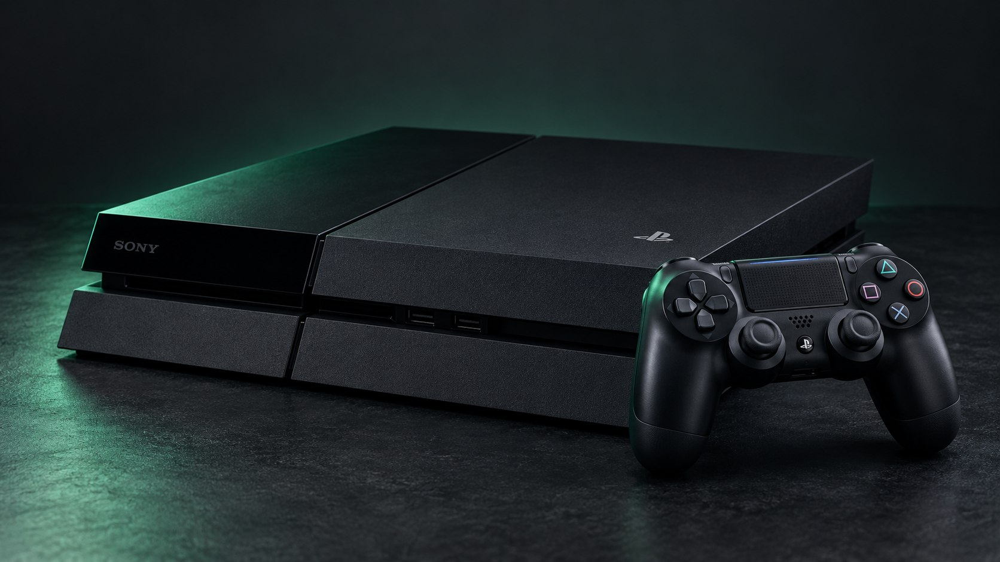

# Console download guides

Choose the console you are using. PS4 and PS5 use different app builds and
different local services; PS3 and Nintendo Switch have their own catalogues.

| Guide | What it covers |
| --- | --- |
| [PS4 downloads and files](ps4-console-downloads.md) | Prepare the local downloader, create a download folder, save files and choose the next action. |
| [PS5 downloads and payloads](ps5-console-downloads.md) | Add the native payload source, use the local downloader and choose mounted storage. |
| [Files and archive extraction](console-files-and-archives.md) | Identify file formats, keep complete packs and extract supported archives without replacing existing files. |
| [New homebrew and app versions](../local-download-updates.md) | Maintainer workflow for checking releases, saving builds and refreshing the local archive. |

Start in the website's [PS4 download centre](../../console/ps4/downloads.html) or
[PS5 download centre](../../console/ps5/downloads.html). The
[host selector](../../hosts/index.html) links to firmware guides and exploit-host
directories when homebrew access has not yet been prepared.

For another platform, use [PS3 downloads](../../console/ps3/downloads.html) or
[Nintendo Switch homebrew](../../console/nintendo-switch.html). Do not substitute
a PlayStation package or payload into a Switch workflow.
