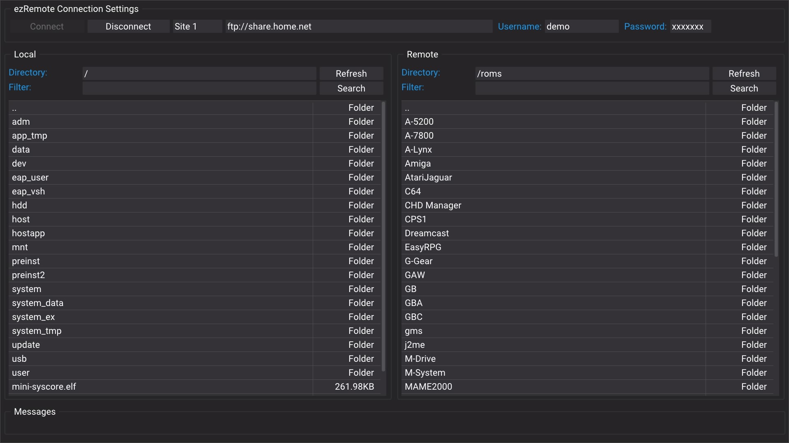

# Console files and archive extraction

Ready console files and complete archive packs serve different purposes. Use the
download centre for [PS4](../../console/ps4/downloads.html) or
[PS5](../../console/ps5/downloads.html), then choose the format required by the
app or game guide.

## Identify what you downloaded

| Format | What to check |
| --- | --- |
| `.pkg` | The package's target console, required firmware and compatible installer. |
| `.elf` / `.bin` | Exact payload platform, firmware and loader. Saving it does not run it. |
| `.prx` / `.sprx` | The console, game version, title ID and plugin-loading environment. The extensions are not interchangeable. |
| `.json` / `.xml` | The documented cheat or patch engine and matching game build. These are data, not executable payloads. |
| `.zip` / `.rar` / `.7z` | The complete pack, required companion files, extraction support and folder layout. |

Choose **Ready files (no extraction)** when an inspected ready build is offered.
Choose **Archives & complete packs** when the app requires supporting files or
the original archive is the available format. Renaming `.rar` to `.zip` does not
convert it.

## Extract a supported saved archive

The site's local companion offers **Extract a saved archive on your console**
through the running ezRemote **Client** file service: PS4 port **8080**, PS5
port **9090**. This is separate from its background download receiver on port
**6701**. Open **Folders & extraction** from the matching download centre, or use
the preparation action supplied by the local downloader.

1. Keep the matching ezRemote Client running and use the companion installed on
   the console, not its public preview.
2. Choose the actual storage folder containing the saved archive.
3. For an archive enabled for the site's extraction action, choose a new output
   folder name and press **Verify checksum & extract into new folder**.
4. Keep the original archive. Confirm the extracted files and required layout in
   the file manager before installing, configuring or loading anything.

The companion's automatic action is deliberately limited to a matching,
content-reviewed catalogue archive of at most **32 MiB**, whose saved bytes match
the recorded SHA-256. Its review must record acceptable relative paths, no links,
device files, alternate streams or encrypted entries, at most 5,000 entries and
at most 128 MiB expanded content. An existing output folder is refused.

An archive without that matching review, an oversized archive, or a format the
installed app cannot handle uses **Open ezRemote file manager** for manual
inspection/extraction. Encryption and unsupported variants may require another
appropriate archive tool. The website does not promise that every RAR/7z works
on every PS4/PS5 file manager. PS4 ezRemote 2.08 documents ZIP extraction; use the
exact app's notes for other formats.

## Preserve complete packs and existing configuration

Keep readmes, licenses, keys, data folders and other files needed by the release.
A loose payload or plugin is not an equivalent replacement for a pack that
requires those files. Do not merge into installation directories until you have
read the matching app/game guide.

For GoldHEN plugins, preserve your existing `plugins.ini` and unrelated game
entries. For an app's data folders, keep the release's documented directory
layout. Download-folder preparation only creates the separate `whatwhatboy`
storage folder; it does not automatically configure GoldHEN or run a mod.

The [PS4 archive guide](../../console/ps4/archive-files.html) documents the
complete Expulsion V5.0 ZIP option and the exact GTA V update/title ID for that
pack. Use its build-specific instructions rather than applying its paths to
another game or menu.

## If something fails

- **Archive download returns a web page:** use the original publisher page or a
  verified local mirror. Do not rename an HTML error response to a package.
- **No writable folder or missing drive:** open the real file manager, verify
  the device is mounted, and prepare or choose a valid destination.
- **Checksum differs:** do not extract that copy through the verified action.
  Inspect the transfer and obtain the matching complete file.
- **Request times out or connection drops:** inspect the native app and output
  folder before retrying; an operation may still be running.
- **The app/game fails after saving:** confirm installation, loader requirements,
  game update and supporting files. A successful download only establishes that
  the file was saved.

For another console, use its own guide and file types:
[PS3 downloads](../../console/ps3/downloads.html) and
[Nintendo Switch homebrew](../../console/nintendo-switch.html). PS3 SPRX and
Switch NRO workflows are separate from this PS4/PS5 companion.
