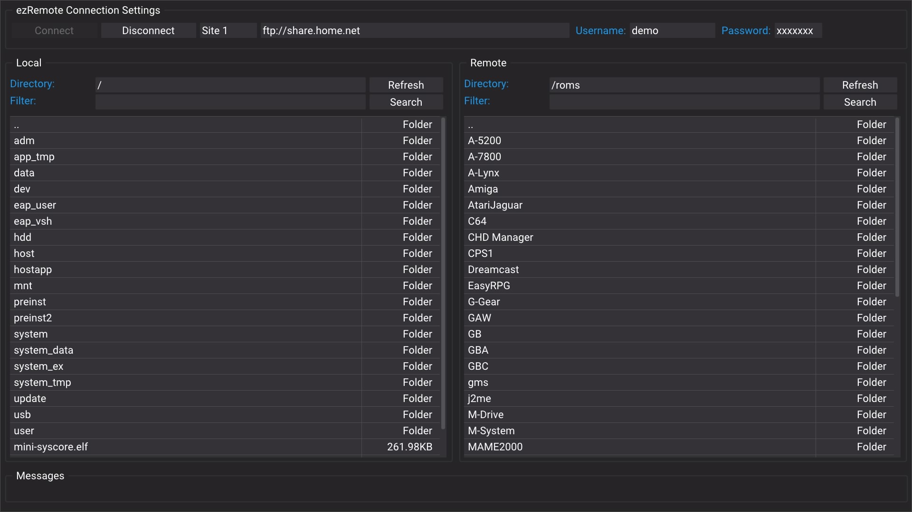

# Download apps and mod files on PS4

Use the [PS4 download centre](../../console/ps4/downloads.html) for PS4 builds.
Keep your installed firmware and check each app's homebrew-enabler requirements.
The website does not establish support for a different firmware merely by
listing a download.

## Choose a download route

The native PS4 catalogue is for **PS4 Games Installer**. Its documented source
setting is **Options > Settings > Games JSON URL**. Copy the source shown in the
download centre, test the connection and save it in the app. The pinned r40
documentation tests PS4 11.00 with GoldHEN; that is not evidence of 14.00 support.

For a file destination you choose yourself, prepare the site's ezRemote
downloader. The ordinary **Download** link saves through the browser you are
currently using. **Save on PS4** opens the separately installed local downloader.

## Prepare ezRemote once

1. Open [PS4 transfer tools](../../console/ps4/transfer-tools.html) and follow the
   matching ezRemote Client 2.08 installation instructions on a supported
   homebrew setup. Enable the required BIN Loader when starting its bundled
   server.
2. Save the companion HTML URL supplied by the download centre as
   `/data/whatsite-ps4.html` using ezRemote's direct-link download feature.
3. Enable background downloads and start ezRemote Server. Keep the console awake
   during a transfer.
4. Open `http://127.0.0.1:6701/data/whatsite-ps4.html` in the console browser.
   The copy on the public website is a preview; it cannot write console files.

When browsing from a phone or computer, use the console's LAN address in the
download centre. `127.0.0.1` means the device running that browser, so it should
only be used as the console address when browsing on the PS4 itself.

## Create a download folder and choose storage

The companion defaults to `/data/whatwhatboy`. Choose **Prepare download folder**
and keep the ezRemote Client app running. This opens the installed companion
through the client's web service on port **8080**, separately from the background
download receiver on port **6701**.

Press **Create or verify download folder** to create a missing `whatwhatboy`
directory or verify an existing one. Creating it requires this explicit action;
saving a file does not silently create arbitrary installation folders.

For USB HDD, SSD or flash storage, inspect the actual mounted device in ezRemote
and confirm its existing writable folder. The pinned PS4 background receiver
does not enumerate USB mounts. A path such as `/mnt/usb0` must be verified on
your console; the number is not a front/rear physical USB-port label.

PlayStation Extended Storage is system-managed game storage. Use an external
destination only when the homebrew service exposes a writable file folder on it.

## Save, then use the correct tool

1. Start with **Ready files (no extraction)** and select the exact PS4 file.
2. Check its firmware, title ID, game update, loader and required companion
   files.
3. Choose the folder, check the receiver, and press **Save to console**.
4. Watch the receiver transfer queue and confirm the completed file in ezRemote.
   A queued request is not a completed download.

| File | Next action |
| --- | --- |
| `.pkg` | Install explicitly with a compatible package installer. |
| `.bin` / `.elf` | Use the loader documented for that specific PS4 payload. |
| `.prx` / script files | Follow the matching game's mod guide and keep required accompanying files. |
| Cheat `.json` / patch `.xml` | Use the matching cheat or patch engine; these are not standalone payloads. |
| `.zip` / `.rar` / `.7z` | Extract with a tool supporting the format, then follow the pack's guide. |

A file for GoldHEN's plugin directory must be placed and configured according to
that plugin's instructions. Preserve existing `plugins.ini` entries and saves;
do not replace the whole configuration with a downloaded example.

For extraction and troubleshooting, continue to
[Console files and archives](console-files-and-archives.md). Browse
[PS4 apps](../../console/ps4/apps.html),
[PS4 payloads](../../console/ps4/payloads.html) or
[PS4/PS5 game mods](../../console/mods/ps4/index.html) for the matching guide.
