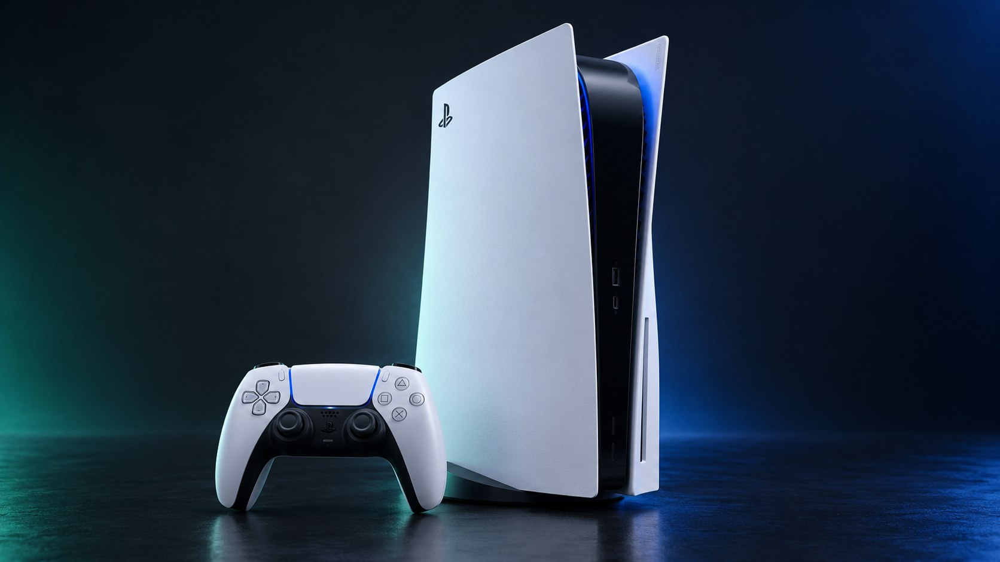
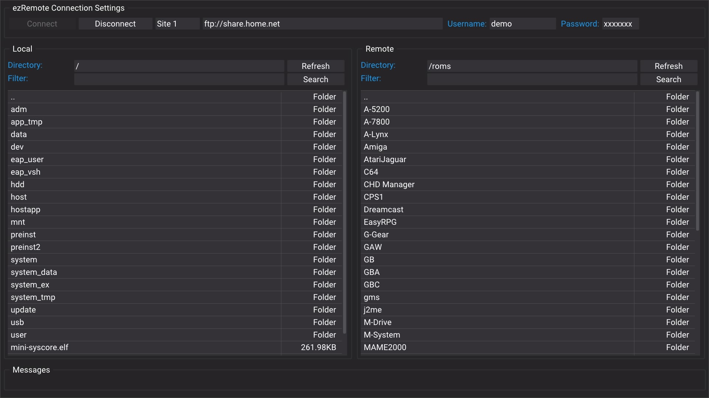

# Download apps and payloads on PS5

Use the [PS5 download centre](../../console/ps5/downloads.html). A PS4 mod or
package listed elsewhere on the site is not automatically a PS5 build. Match
firmware, loader, game update and title ID before choosing a file.

## Use the native payload catalogue

In the documented **PS5 Payload Manager 0.6.3**, open **Settings > Manage Sources > Add Source**
and paste the source URL shown in the PS5 download centre. This
source contains ready PS5 ELF/BIN payloads with checksums. The documented manager
location for repository downloads is `/data/pldmgr/payloads/repo/`.

Open the site's [Payload Manager page](../../console/ps5/payload-manager.html)
for its loader and service requirements. Repository downloads, app packages and
complete archive packs are different things; the payload feed does not install
every kind of PS5 homebrew.

## Prepare the local downloader once

1. Follow [PS5 transfer tools](../../console/ps5/transfer-tools.html) for ezRemote
   Client **2.18**, its websrv requirement and the documented homebrew-folder
   layout.
2. Save the download centre's companion HTML URL as
   `/data/homebrew/ezremote-client/assets/whatsite-ps5.html`.
3. Enable ezRemote background downloads and start its bundled server. Leave the
   background server running and keep the console awake during a transfer.
4. Open `http://127.0.0.1:6701/whatsite-ps5.html` in the PS5 browser. The public
   copy of the companion is a preview with saving disabled.

From another device, enter the PS5's actual LAN address in the download centre.
Use `127.0.0.1` only when the browser itself is running on that PS5.

## Prepare internal or mounted external storage

The download folder defaults to `/data/whatwhatboy`. Choose **Prepare download
folder** to open the installed companion through the running ezRemote Client on
port **9090**. Press **Create or verify download folder** to request creation of
the missing `whatwhatboy` directory or verify the existing folder.

The client must remain running for folder creation and extraction. The
background receiver on port **6701** handles download requests; it does not
provide those client file-management operations by itself.

For external storage, choose **Detect mounted storage** with PS5 websrv running
on port **8080**. Select an actually detected writable mount and verify the
destination folder. The downloader checks the mount again before saving, so a
disconnected drive is not treated as present just because its old directory
still exists.

USB mount numbers do not identify physical USB sockets. System-managed
PlayStation Extended Storage is usable here only if the homebrew service
exposes a writable general-purpose folder on it.

## Download, inspect and launch separately

Choose **Ready files (no extraction)** for the simplest path. Select **Save on
PS5**, then choose the destination and press **Save to console** in the local
companion. Use the receiver queue and file manager to confirm completion.

Downloading an ELF/BIN payload does not run it. Use the selected payload's
documented compatible loader or manager and launch it explicitly. An etaHEN
`.plugin` follows etaHEN's plugin installation flow; it is not a standalone ELF.
A PKG needs a compatible package installer. Keep an archive's full accompanying
data instead of assuming that one extracted binary is the whole app.

If a file or partial copy already exists, inspect it in ezRemote or choose a
different destination rather than repeatedly submitting the same transfer.
For an uncertain submission or lost queue record, inspect the destination before
retrying.

Continue to [Console files and archives](console-files-and-archives.md), or browse
[PS5 apps](../../console/ps5/apps.html),
[PS5 payloads](../../console/ps5/payloads.html) and
[PS5 transfer tools](../../console/ps5/transfer-tools.html).
