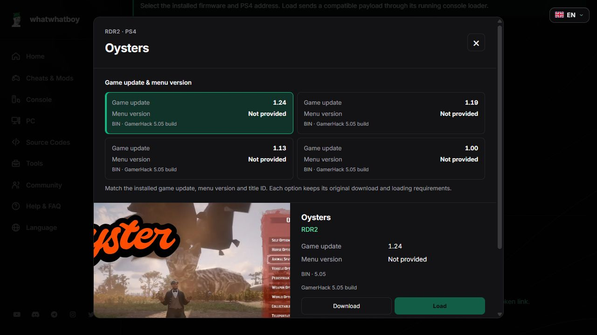

# More reviewed PS4 host files

This batch adds four original Oysters builds for the GamerHack **5.05** host and the original stable **hippie68 FTP Server 1.08b** for the reviewed **9.00** loading route. Previous menu builds, original-file Load controls, native workspaces and archived helper versions remain available.

## Oysters on firmware 5.05

The PS4 host's **RDR2** child page groups these files under the existing **Oysters** family. Choose firmware **5.05**, enable older builds if hidden, open the version popup and match the exact **game update**:

| RDR2 game update | File | Bytes | SHA-256 |
| --- | --- | --- | --- |
| 1.00 | `OystersMenu-v1.00.bin` | 1,260,864 | `09925fe9288bd9e68f49ffaffba3e92fb6ddb1c8cf416e16251cdef53f19a67a` |
| 1.13 | `OystersMenu-v1.13.bin` | 1,260,864 | `38f847706303c2c2b5b71102073ac86fa534f1bc09b6c40129275a53b0c81718` |
| 1.19 | `OystersMenu-v1.19.bin` | 1,260,864 | `93fd71c737f4433f72dd594685303e23183859fa448dfafefc15bd8906676f7e` |
| 1.24 | `OystersMenu-v1.24.bin` | 1,260,864 | `b5566c5629c86f8860ba190537e0c2a2e220c879f469a155b924467b975ec08d` |

Independent menu release numbers and regional title IDs were not supplied. The matching game build must already run on the console; a menu listed in a 5.05 host does not establish stock-game boot or backport compatibility.

**Download** uses the pinned original file or its exact console receiver ID. **Load remains disabled**: the source maps these files to its in-page native loader, but a matching standalone GoldHEN HTTP, TCP BIN or ELF ABI has not been established. These are distinct hashes from the retained 9.00 variants; firmware pins on older entries are unchanged.

All four originals are privately archived with version, source URL, size and checksum. No public binary mirror or runtime redistribution permission is implied.

## hippie68 FTP Server 1.08b

The new **FTP Server · hippie68** card appears under PS4 **Tools** and **Payloads** on firmware **9.00**. Its original release file is `ftp_server_v1.08b.bin`, **37,824 bytes**, SHA-256 `695082f37c5cfdce14a06fbd567fa8651017ee2e31f3e95ae7a769b4287cb0e9`.

1. Download the original author's stable BIN onto the computer running the paired desktop sender.
2. Start compatible GoldHEN on the PS4 and enable its HTTP BinLoader on **9090**. Pair the current sender and select firmware **9.00**.
3. Choose **Load** and select the exact original BIN. Browser and sender verify its size and hash in memory; no selected binary is saved by the sender or bundled in its ZIP.
4. Check the console notification. After it reports the FTP address, use an FTP client on the same LAN with the PS4 address and port **1337**. The custom FTP command `SHUTDOWN` stops this server. Do not launch another instance while that port is in use.

The author's pinned 9.00 host explicitly uses the GoldHEN HTTP route for the FTP payload and separates WebKit-only payloads. The release/source supports additional firmware, but this action remains pinned to the exact 9.00 route reviewed here. This is separate from the existing ELF FTP server, GoldHEN's own FTP service and native ezRemote workspaces.

For a console copy, use **Download** separately and turn off copy-on-Load before choosing a local BIN. See [selected-file loading](host-original-tool-loading.md). HTTP acceptance confirms delivery, not execution or successful FTP access.

## Exclusions and verification

`505/arabic-guy127.bin` in the reviewed GamerHack tree is JavaScript containing a payload array, despite its extension. It is not exposed as a ready raw BIN. Some 6.72 menu branches also use script injection for files with native BIN headers; their standalone loading and success remain unproved.

The reviewed original 9.00 host explicitly treats dumper, history blocker and web activator files as WebKit-only. The examined database backup source deletes an existing backup directory before writing; it was not added in this batch. No generic BIN compatibility is inferred from an extension or nearby menu button.

Detailed evidence is in [remaining menu review](/docs/qa/host-remaining-menu-review.json) and [utility source review](/docs/qa/host-next-utility-source-review.json). Preparation uses file/hash inspection and authored mocks. No downloaded payload, exploit page or real console was executed or contacted.
