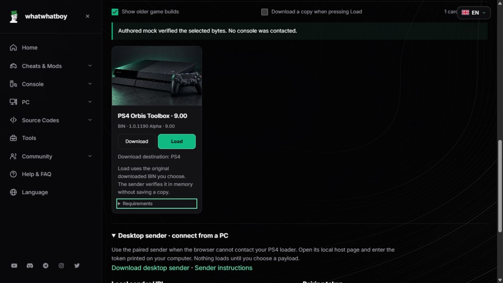

# Original-release BIN files and selected-file loading

The PS4 host now includes the original Orbis Toolbox **1.0.1190** files for **5.05, 6.72, 7.02, 7.55 and 9.00**, plus the official GoldHEN **2.4b18** ready BIN for the existing **9.00** bootstrap. Older menus, GoldHEN 2.3, receiver snapshots and sender ZIPs remain available.

These Download controls point to the original author files. The binaries are privately archived on F: with their source URLs, versions, sizes and SHA-256 hashes. They are not publicly mirrored or bundled in the desktop sender. The original GoldHEN release archive is retained separately from its ready BIN; extracting that archive only reproduced the exact pinned official `goldhen.bin` bytes.

## Download and Load

1. Download the original matching BIN onto the computer running the desktop sender. The merged Download control downloads to this device when no console address is configured. If a console address is already set, it uses the exact console receiver; use the original author's release link under Requirements to obtain a computer copy as well.
2. Start the current paired desktop sender, open its localhost dashboard and enter the fresh terminal token. Select the PS4's LAN address and exact installed firmware. Older senders without selected-file support cannot unlock these Load buttons.
3. Start the correct native console loader, as described below. Choose **Load**, then select the exact downloaded `.bin` file in the computer's file picker. Renaming a file does not make incompatible bytes valid: both browser and sender verify its complete size and SHA-256.
4. Review the transfer result and the console itself. Cancelling the picker, selecting the wrong bytes or changing the console/pairing settings during verification sends nothing. An uncertain transfer result retains the existing warning and must be checked before another Load.

For these original-only files, use **Download** separately if you want a console copy. Turn off **Download a copy when pressing Load** before opening the file picker. A source file is not saved by the sender or stored in browser storage.

Expand **Requirements** to see the exact expected filename, byte count and SHA-256 before choosing a file. These technical values remain literal when changing language. The OS/browser's MIME label is not used as file identity: the `.bin` extension, declared and actual size, complete hash and format checks still apply.

### Orbis Toolbox

The original release requires a compatible **HEN first**, then the **firmware-specific Orbis Toolbox BIN**. It is for retail executables; it does not support Hybrid Flasher or Updater POC. It is an alpha pre-release, and GoldHEN's original release notes identify possible rest-mode problems with Orbis Toolbox.

Selected-file Load is available here for **5.05, 6.72 and 9.00**, through an already running compatible **GoldHEN HTTP BinLoader on port 9090**. The sender reads `/status`, requires `ready`, then submits the verified raw BIN once. HTTP acceptance is not proof that the Toolbox executed.

The **7.02 and 7.55** files remain download-only. The author's HEN requirement does not by itself establish a compatible GoldHEN HTTP route for those firmware builds. Use the original native loading instructions.

### GoldHEN 2.4b18 on PS4 9.00

Start the existing guarded first-party PSFree/Lapse runtime **on the PS4**, choose Start explicitly and wait for its own **TCP 9020** BIN-listener message. Then use **GoldHEN 2.4b18 · 9.00 → Load** in the paired computer dashboard and select the official `goldhen.bin`.

The ready file is **260,160 bytes**, SHA-256 `eb9fee5e9e3618c0a144a6fc6b8fc1ec7e89cf06483ad64ae7c1085efc9525a3`. Its bytes match both the original 2.4b18 archive and the pinned official beta branch file. This action uses one raw TCP 9020 connection, exact bytes and EOF, with no readiness probe or automatic retry. TCP transfer completion does not confirm GoldHEN execution.

This is the official **2.4b18** release, separate from the host-advertised **2.4b18.12** build. The source release lists other supported firmware, but this Load action remains pinned to the existing 9.00 bootstrap. PPPwn's release-specific custom stage2 is a separate route. No PS4 13.xx, 14.00 or PS5 support is inferred.

## Implementation and checks

The paired sender exposes a bounded `/api/run-file` operation only for curated `run.input = "user-file"` actions. It requires its existing pairing token and localhost origin, exact action/platform/firmware/game fields, BIN format, declared bytes and SHA-256. The selected bytes stay in memory. The route accepts no file path, download URL, custom port or arbitrary transport. It rejects ELF content, compressed bodies and invalid, oversized, interrupted or timed-out uploads before console contact. The browser rechecks console and pairing settings immediately before dispatch, including after asynchronous file hashing.

Existing local-file `/api/run` actions retain their previous behavior. They cannot be used to bypass a selected-file action's checks. Existing native file/autoload workspaces and their backup procedures are unchanged.

The exact source evidence and build hashes are in [the original-tool review](/docs/qa/host-original-tool-source-review.json), [action metadata](/docs/host-original-tool-actions.json) and [archive jobs](/docs/host-original-tool-jobs.json). Source inspection, file hashing and authored mock tests do not establish physical console execution. No downloaded exploit or payload was executed during this work.

